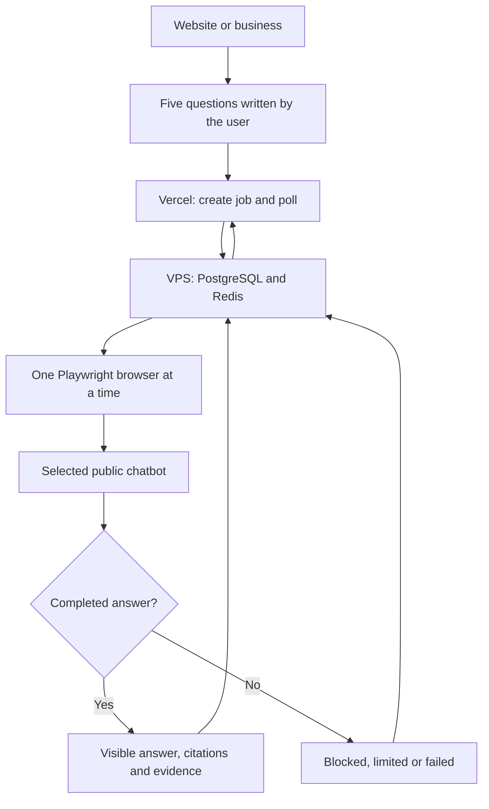

# DoctorFizz Browser Visibility Checker — v1.4

Prepared from the original v1.1 ZIP. This revision uses **Playwright on the VPS**, not LLM API integrations. No GitHub push or team sharing is needed.

Users enter a website or business name, then type **their own five questions** (8–1,000 characters each, any language). There are no generated suggestions or prompt-selection cards. The five questions run across up to four selected chatbot sites: four sources produce **20 separate browser runs** in one batch. A batch consumes one free check.

The collection panel shows each question and source, its URL and the actual worker stage: **queued → opening → sending → waiting → collecting → saving → answer saved**. Completed answers appear while remaining runs continue. Progress is based on persisted run status, with no simulated percentage. Results have question tabs, original captured text, citations and browser evidence. Detailed collection cards collapse at completion and can be reopened. The layouts were designed for mobile, tablet and desktop.

## Browser providers

| UI choice | Website | Current verification |
| --- | --- | --- |
| Microsoft Copilot | https://copilot.microsoft.com/ | Candidate selectors; VPS verification pending |
| Perplexity | https://www.perplexity.ai/ | Candidate selectors; VPS verification pending |
| Grok | https://grok.com/ | Candidate selectors; VPS verification pending |
| Duck.ai | https://duck.ai/ | Candidate selectors; VPS verification pending |

Duck.ai is identified as Duck.ai, not as ChatGPT or Claude. These are service snapshots, not claims about a fixed underlying model. The UI initially says **Browser access not tested**. Missing LLM API keys no longer disable the choices.

**Important acceptance boundary:** the code and local fixtures are tested. Live selectors and public access have not been verified. The local network could not reach the sites; a subsequent live cloud-browser check was rejected by automatic approval review because its usage allowance was exhausted. Run the included VPS probe before calling any provider ready. A provider that needs login, consent, CAPTCHA or a paid plan returns a blocked/limit status. Four dependable, permanently free, anonymous services cannot be guaranteed by code. There is no automatic account creation, safeguard bypass, hidden API replay, cached-answer substitution or fabricated result.

## What changed

- Ten API choices replaced with four public-browser adapters.
- No LLM API keys, model IDs, paid classifier/extractor, provider cost ceilings or daily dollar budget required.
- Five required user-written questions, validated on both client and server. The server checks business-profile ownership.
- Each run stores its own question, source, collection stage and answer. Old single-question result links remain readable.
- Questions explicitly naming the brand are labelled **Direct brand query** in the readout, evidence and CSV.
- One browser generation at a time, one pending check by default, 90-second provider timeout. The overall deadline is run count × 90 seconds + two minutes: at most 32 minutes for 20 runs. A batch can take several minutes; failed attempts end earlier. Serial processing keeps VPS memory use bounded alongside existing tools.
- Vercel creates jobs and polls progress using short requests; the VPS performs browser work. No long generation request on Vercel.
- Fresh browser sessions per question/source, no reused answers or provider cookies.
- Captures completed visible answer content and links within the answer. Navigation, user text, hidden content and control labels are excluded. Ordered-list labels are retained for ranking analysis.
- Evidence includes source page, capture time, SHA-256 of captured answer and observed completion signal. Model/search information stays unknown unless visibly confirmed.
- Failed runs excluded from scoring. If every run fails, the batch attempt is refunded.
- Existing signed sessions, hashed-IP limits, safe website fetch, CSV export and delete-data flow retained. External bot-verification credentials are optional and disabled by default.

## Prepare and deploy

Follow [the VPS/Vercel upgrade guide](docs/DEPLOYMENT_VPS_VERCEL.md), including command outputs and the live acceptance probe. The included upgrade script backs up this app and its database, retains its `.env` and Docker volumes, and upgrades only the **doctorfizz-llm** project on **127.0.0.1:8089**. Existing rank/SEO tools and Caddy routes are preserved by the script.

The existing database password, IP salt and Vercel↔VPS shared secret are infrastructure settings, not LLM API credentials. They remain necessary to operate your current deployment safely.

## Architecture



## Local development and tests

Node 24 and existing PostgreSQL/Redis are used. Docker worker image includes Playwright's matching browser. `.env.example` contains only runtime settings and optional controls.

```bash
npm ci
npm run typecheck
npm test
npx playwright install chromium
npm run test:e2e
npm run build
```

Browser tests serve controlled local HTML, and UI tests intercept transport with explicit test-only fixtures. They establish correct capture/queue/UI behavior, not upstream website availability. Production never imports a fixture adapter. See [verification](docs/VERIFICATION.md).

## Browser reliability fixes (v1.4.1)

Only the browser worker changed; the UI, API, database and scoring are untouched.

- **False "blocked" on every source.** The old barrier treated any visible "you agree to the Terms / Privacy" text as a consent wall. Those lines sit under the composer on Copilot, Perplexity, Grok and Duck.ai, so healthy pages were rejected. Consent now counts only when the composer is absent; login, limit and verification wording is matched more precisely.
- **False "rate limited".** The page echoes the user's question; a question mentioning "too many requests" used to be read as a limit. The question text and the composer are now excluded from barrier checks.
- **Answers never "completed".** Copy/Regenerate controls usually sit in a toolbar beside the message, not inside it. The completion check now looks in the answer and a few wrapper levels above it (never across the composer, page header or another answer; "Copy code" buttons ignored).
- **Hidden pre-existing nodes.** The "before" answer count included hidden nodes while the live count did not, so a hidden template could hide the real answer.
- **Enter does nothing / rich editors.** If Enter does not submit, the send button is used once; composers that ignore `fill()` are typed into without doubling text.
- **Welcome / terms notices** (e.g. Duck.ai "Agree and Continue", cookie "Accept") are acknowledged. This is a deliberate, narrow relaxation of "stop at consent": sign-in, sign-up, account, social-login and payment controls and any dialog with an email/password field are never clicked, and an unacknowledgeable wall still fails as blocked. Set `BROWSER_DISMISS_NOTICES=false` for the strict behaviour.
- **Headless identity.** The browser now runs as regular Chrome (full Chromium in new headless mode, normal User-Agent, desktop viewport) instead of `HeadlessChrome`. No fingerprint spoofing and no verification bypass: a CAPTCHA or "verify you are human" screen is still reported as blocked. `BROWSER_PROXY_*`, `BROWSER_HEADED`, `BROWSER_USER_AGENT`, `BROWSER_TIMEZONE` are available for datacenter-IP problems.
- Selectors are broader and case-insensitive; one field can be repaired without a rebuild via `BROWSER_SELECTOR_OVERRIDES`. Barrier checks are ~3.5x cheaper on long pages. A browser start failure now reports its first error line instead of a generic message.

**Still required on the VPS:** these sites' live markup could not be reached from the build environment, so selectors remain candidates. Run `npm run browser:probe -- --submit` (add `--provider=duckai` for one source). If a source is not `ready`, run `npm run browser:probe -- --inspect --provider=<id>`; it saves a screenshot and a JSON list of answer-like elements and Copy/Stop/Send buttons under `internal-debug/`, from which the right selector can be set.

## Updating a provider UI

The input, assistant answer, completion control and stop control selectors live in `src/worker/browser.config.ts`. Keep answer selectors specific to the assistant response. Never fall back to capturing the whole page or an arbitrary article. The collector requires a new assistant answer after submission and either its completion control or an observed generation-stop transition. Stable text alone does not establish completion.

After any selector change, rebuild only this worker and rerun `browser:probe --submit`. Disable a failing provider with `BROWSER_DISABLED_PROVIDERS=copilot,perplexity-web,grok-web,duckai` as appropriate. Exclude only failed IDs; the four choices remain documented as candidates until individually verified.

Current scoring is deterministic and conservative: explicit list recommendations, bounded brand aliases, matching citation hosts and neutral sentiment when uncertain. It cannot reproduce subjective model-based sentiment analysis without an additional model. A general mention is kept distinct from an ordered recommendation.
